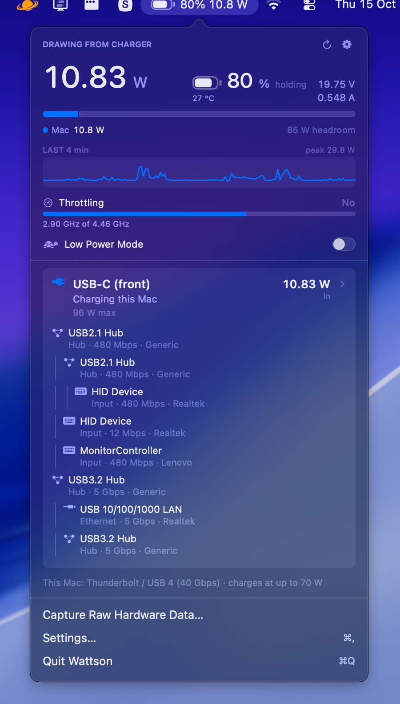
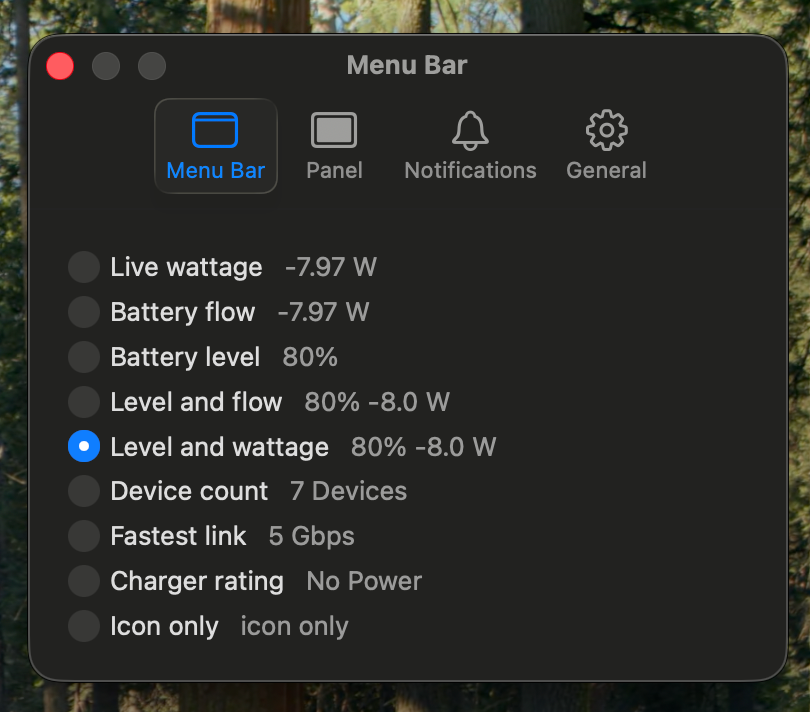
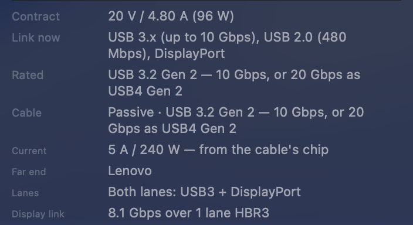
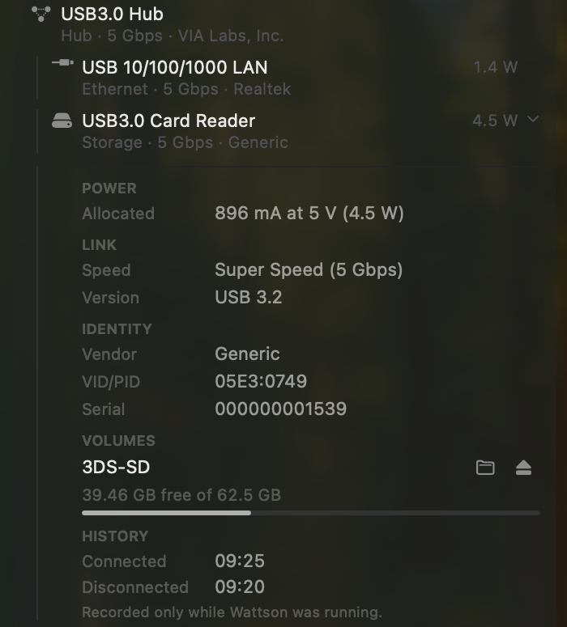
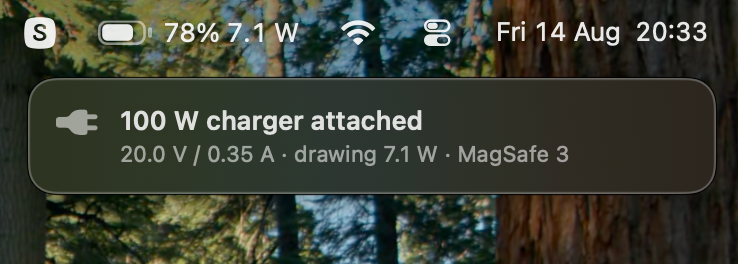
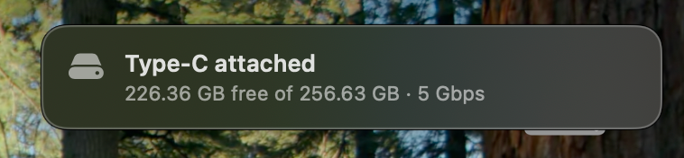

<div align="center">


<h1>Wattson</h1>

<p>
  <strong>A menu bar battery that says what it is actually doing.<br>
  Then keeps going: where every watt lands, and what is on the<br>
  other end of each USB-C cable.</strong>
</p>

<p>
  <a href="https://github.com/TheFilipcom4607/wattson/releases/latest"></a>
  
  <a href="LICENSE"></a>
  
  
  
</p>



<p>
  <sub>One USB-C cable to a monitor: it charges the Mac, carries the picture, and<br>
  has a hub, a keyboard and an ethernet adapter hanging off it.</sub>
</p>

</div>

Turn off the system's battery item and put this in its place. It is the same
battery, drawn to the same proportions, in the same corner — except that it also
tells you what the machine is drawing, switches Low Power Mode, and opens onto
everything your Mac knows about its power and its ports and has never shown you.

**Free, open source, and it stays on your Mac.** No account, no subscription, no
"Pro" tier holding back the useful half. It makes no network connections at all
and asks for no permissions; everything it shows is read straight from the SMC
and the IORegistry.

### At a glance

- **Watts in the menu bar** — `78% 45.3 W` on a charger, `78% -5.1 W` off it — on a
  battery icon drawn from the real percentage, not rounded to the nearest quarter.
- **Where the power goes** — Mac, accessories and battery as one bar, against what
  the charger can supply, with the charger's own PD contract and voltage ladder.
- **What each USB-C cable really is** — its e-marker's speed and current rating, who
  made it, and whether it has the wires for USB 3 at all.
- **Why something is slow** — which transport took the port's high-speed lanes, what
  the Thunderbolt link actually came up at, and whether a display is being
  compressed to fit.
- **Whether the Mac is being held back** — achieved clock against its ceiling, and a
  reason only when there is one it can see.
- **Low Power Mode** in one switch, which macOS gives no API for at all.
- **Every device on every port**, with what it is drawing, its link speed and serial,
  its volumes, and when it last came and went.
- **About 16 MB** sitting in the menu bar.

---

## Install

With Homebrew:

```bash
brew install --cask TheFilipcom4607/tap/wattson
```

Or download the DMG from [Releases](https://github.com/TheFilipcom4607/wattson/releases/latest)
and drag Wattson to Applications. Both are signed with a Developer ID and notarized, so
they open on a double-click.

Needs an Apple silicon Mac running macOS 13 or later.

To use it as your battery item, set **Menu Bar** in Settings to **Level and
wattage**, then turn the system's own battery off in System Settings ›
Control Center › Battery.

### From source

```bash
./build.sh --install
```

Compiles in release, assembles `Wattson.app`, signs it ad-hoc, copies it to
`/Applications` and launches it. Drop `--install` to just build into `build/`. Needs a
Swift 5.9 toolchain; the Command Line Tools are enough, Xcode is not required.

> [!TIP]
> A build from source is signed ad-hoc, so Gatekeeper will refuse the first launch.
> Right-click the app in `/Applications` and choose **Open** once, and it will start
> normally after that.

---

## The battery item

<div align="center">
  

</div>

- **A battery drawn from the real figure.** SF Symbols ships battery art in five
  steps — 0, 25, 50, 75, 100 — so a symbol can only ever round 61% to the nearest
  quarter. This one is drawn, at the proportions of the battery macOS puts in its
  own menu bar, with the charging bolt cut through the charge the way Apple's is,
  and it turns yellow in Low Power Mode exactly as the system's does.
- **A wattage beside the percentage**, which is the part the system item has never
  told you. **Level and wattage** reads `78% 45.3 W` on a charger — what is arriving
  from the wall — and falls back to the cell's own flow once you unplug.
  **Level and flow** reads `78% +38.4 W` instead, always signed, for what the
  battery itself is doing. Or **Battery level** for the plain percentage, and
  **Icon only** for nothing but the battery.

  <div align="center">
    
  </div>

  <p align="center">
    <sub>Every mode previews what it would actually put up there, live — the labels<br>
    alone never told you what you would get.</sub>
  </p>

- **Low Power Mode**, switched from the panel. macOS exposes no API for it at all —
  not in IOKit's headers, not in the PowerManagement plists — so `pmset` is the only
  way in and only root may write it. The first use offers to install
  `/etc/sudoers.d/wattson`, granting your account one command with two exact
  argument lists and nothing else. It is checked with `visudo` before it goes in and
  again once it is there, removed again if that second check fails, and revocable
  from Settings.

  <div align="center">
    
  </div>

- **The charge again in the panel**, at a size you can read across a desk, next to
  what is flowing and which way, how long the battery has left (or how long until
  it is full), and how warm the pack is.

---

## Then everything else

### Power

- **Where that power goes** — a single stacked bar splitting the Mac's own draw,
  attached accessories, and charge going into the battery, sized against what the
  charger can actually supply.
- **What this Mac will take**, so you can tell whether the charger is the thing
  holding you back or the machine is.
- **Which charger it is.** The brick's own name, who made it, its firmware and
  serial, the PD contract it agreed and every voltage it offered — with an Apple
  mark on the card when the adapter reports Apple as its manufacturer.
- **A warning when the battery is going down on a charger**, which is the one
  charging fault nothing else on the machine will tell you about. It reports
  measured facts only — what is coming in against what the Mac is drawing — and
  says nothing about what a bigger charger could have delivered: a small brick
  holding a machine level is doing its job.
- **Whether the machine is being held back.** macOS publishes a thermal pressure
  level and nothing else — no frequency, no reason — and under sustained load it
  will happily read "normal" while the performance cores are pulled down from
  their peak. Wattson reads what the cores actually ran at against what this
  Mac can do, and names a reason only when it can see one: Low Power Mode, heat
  macOS has admitted to, or a charger the battery is draining underneath. A Mac
  running slowly because nothing is asking it to go faster is not throttled, and
  is not called throttled.
- **The battery's condition** — capacity against design, cycle count, and the
  pack's temperature — with a warning only when the pack's own gauge has latched
  a real fault.

### Cables and ports

<div align="center">
  
</div>

<p align="center">
  <sub>The same monitor's card, expanded. The cable's own chip says 5 A, the port's two lanes<br>
  are split between USB 3 and DisplayPort, and the next row down works out that 4608 × 2592<br>
  at 60 Hz needs at least 21.5 Gbps uncompressed over a link carrying 8.1 — so the<br>
  picture is being compressed (DSC).</sub>
</p>

- **One card per physical connection.** A port and the device on the end of it are
  the same cable, so they get one card: what it is, which port, what is flowing and
  in which direction. Expand a card for the PD contract, the voltage ladder, how
  the cable is wired, and what it is certified to carry.
- **Cable diagnostics** — whether a cable has SuperSpeed lanes and sideband pins at
  all, which is usually the answer to "why is this drive slow".
- **What the cable's own chip says it can carry** — its speed, its current and
  voltage ratings, and who made it. This is read from the cable's e-marker over
  SOP', which is what separates a 3 A cable from one rated for 5 A. A cable
  idling with nothing on its far end is never interrogated and gets no rating;
  neither does one whose chip answers with nothing. In those cases the panel
  falls back to what the hardware actually negotiated through the cable, and
  says which of the two you are looking at rather than blurring them together.
- **How the port's two high-speed lanes are actually assigned**, which is the
  real answer to "why is the dock's ethernet crawling when the monitor is
  plugged in". DisplayPort alt mode takes lanes; take both and USB 3 has no
  wires left, so everything on that connector drops to USB 2.0 whether or not
  it is capable of more. The port still advertises USB 3 as supported the whole
  time, because the port is still capable of it — nothing else on the Mac tells
  you this.
- **Whether the picture is being compressed.** When a display's mode needs more
  bandwidth uncompressed than the link it negotiated can carry, and it is being
  displayed anyway, it is being compressed. That inference only runs one way:
  the figure Wattson computes is a floor — real timings need more — so
  exceeding it proves the mode does not fit, while coming in under it proves
  nothing. It will tell you a link is demonstrably too narrow. It will never
  tell you one is adequate.
- **What the Thunderbolt controller behind each port is**, and what the link
  actually came up at when one is running. The port's transport list says what a
  port is *capable* of and reads the same whether it is empty or carrying a dock;
  this is the controller's own account — its generation, how many lanes it has,
  and what it settled on. An achieved link is only ever reported when the port
  says Thunderbolt is genuinely running, because an idle port reports a
  convincing-looking link with nothing attached at all.
- **Liquid in a connector.** Every USB-C port has a detection circuit, and macOS
  shows its own alert the moment it fires and nothing afterwards — so a port
  that has quietly stopped charging leaves nothing to go and look at. Wattson
  says which port, and keeps saying it while the condition holds.

### Devices

- **What each device is.** Click any device in the tree and it expands in place: its
  power allocation in mA as well as watts, how fast its link actually came up
  against what it says it can do, vendor, VID/PID and serial number.
- **Volumes.** A drive mounted from a USB device is listed under it with its free
  space, a Show in Finder button, and an eject that unmounts the whole disk rather
  than one partition of a two-partition stick.
- **Connection history**, and **search** once the tree is long enough to need it.

<div align="center">
  
</div>

### Notices

Off by default, switched on by kind in Settings: chargers, drives and cards, or
everything else that plugs in. Each notice carries what is worth knowing rather
than just a name — a drive's free space and link speed, a charger's rating, the
contract it agreed and what it is actually delivering.

Nothing waits and nothing is announced twice: a drive's notice appears the moment
it is on the bus and fills in its size in place when the volume mounts. They show
beside the menu bar, in Notification Center, or both.

<div align="center">
  
  
</div>

---

## Privacy

Wattson makes no network connections: no update check, no analytics, no crash
reporter. It uses no Bluetooth and puts up no permission prompts. The one thing it
ever asks for is your password, once, if you choose to switch Low Power Mode from
the panel — see above for exactly what that installs and how to take it out.

Updates come through Homebrew (`brew upgrade --cask wattson`) or a new DMG from
Releases, whenever you decide to get one.

---

## What it costs to run

About **16 MB** sitting in the menu bar, and about **40 MB** once the panel has
been opened — where it stays, however many times you open it again. Those are the
figures Activity Monitor shows as Memory. It samples every 2 seconds while idle and
every second while the panel is open, and the clock-speed reader only exists while
you are looking at it.

The panel is not kept between openings: its contents are built when you open it
and given back when you close it, and only the popover and its one window live in
between. Settings and the capture window work the same way. Keeping the whole thing
alive is the ordinary thing to do, and it cost more than everything else in the app
put together.

What the first opening does leave behind is the system's, not the panel's: tables
for converting colours to the display's, decoded symbols, SwiftUI's own
bookkeeping. They are kept for the next drawing until macOS wants the memory back.

Monitors that show resident size — Stats, iStat Menus, `ps` — report a much bigger
number: about 50 MB before the panel has been opened, and over 100 MB after. Most
of that is AppKit, SwiftUI, the system font and the SF Symbols catalogue, which
every app on the Mac shares. Quitting Wattson would not give any of it back.

---

## Command line

The binary lives inside the bundle:

```bash
/Applications/Wattson.app/Contents/MacOS/Wattson --dump
```

| Flag | |
| :--- | :--- |
| `--dump` | Prints one reading — power, ports, devices, battery condition, each port's lifetime fault counters — as plain text, and exits. |
| `--json` | The same reading as JSON, for anything that has to read it rather than look at it. |
| `--watch` | Prints the input / load / battery line once a second until interrupted. |
| `--health` | One line per hardware source saying whether it answered. Run it before and after a macOS update. |
| `--selftest` | Replays recorded hardware captures through the readers and reports what broke. Touches no hardware. |
| `--capture "name"` | Writes a raw hardware capture to the working directory and prints its path. |

`--capture` is the one to reach for when something unfamiliar is plugged in and
you have thirty seconds. It records the unparsed sources — the whole IOKit
service plane, every SMC key the controller admits to, the USB BOS descriptors
that no `ioreg` invocation can produce, every display mode CoreGraphics offers
— and none of Wattson's own conclusions about them. That is the point: it is
the evidence, so a reading can be worked out afterwards from a capture instead
of from the hardware.

Several sections are empty unless something is attached, and say so where they
are. A cable's e-marker only answers when there is something at the far end; a
port's DisplayPort and USB3 transport nodes exist only while those transports
are up; an idle port's lanes are parked. A capture taken with a dock running
is worth a dozen taken idle.

> [!WARNING]
> A capture carries serial numbers — the Mac's, the battery's, and every
> attached device's. Read it before sending it to anyone.

---

## Notes

**It reports nothing rather than guess.** A Mac missing from the model table shows
no charge ceiling; a cable whose chip answers with nothing gets no rating; the
throttling line names no reason unless it can see one. Where a figure is missing,
that is usually why.

> [!NOTE]
> **Port positions are guesswork.** Port numbering says nothing about physical
> position, so the mapping from port number to "front" and "rear" was established by
> hand on one machine and may not match yours. The controller-to-port map used to
> attribute measured power to a specific device re-learns itself at runtime whenever
> exactly one port is occupied.

**Maximum charging wattage is the one figure here not read from the hardware.**
macOS publishes a great deal about the adapter attached to a Mac and nothing at
all about what the Mac itself will accept, so that number is a table of Apple's
published ratings keyed on the model identifier. If yours is missing, an issue with
the output of `sysctl hw.model` is all it takes.

**Battery capacity** is shown clamped to 100% because a pack fresh from the
factory genuinely holds a little more than its design figure — that number is a
floor the cells are built to clear, not an average — and `--json` reports it
unclamped. "Service recommended" appears only when the gauge has latched a real
fault; wear is not a fault, and a pack at 79% is working as designed.

**History keys on the serial number**, so it survives the device being moved to
another port. Plenty of hubs and card readers report no serial at all; theirs keys
on the port instead, and the panel says so rather than implying a history it
cannot stand behind. Nothing is recorded while Wattson is not running.

**Hardware it has not met.** Wattson has been built against the hardware on one
desk. If something reads wrong or not at all — a Thunderbolt dock especially —
an issue with a `--capture` attached (read the warning above first) is the most
useful thing you can send.

---

## Acknowledgements

Several facts about undocumented Apple interfaces were first worked out in
[whatcable](https://github.com/darrylmorley/whatcable) and
[whatport](https://github.com/darrylmorley/whatport), both MIT-licensed, and
the doc comments in the source say where.

## Licence

[MIT](LICENSE).
